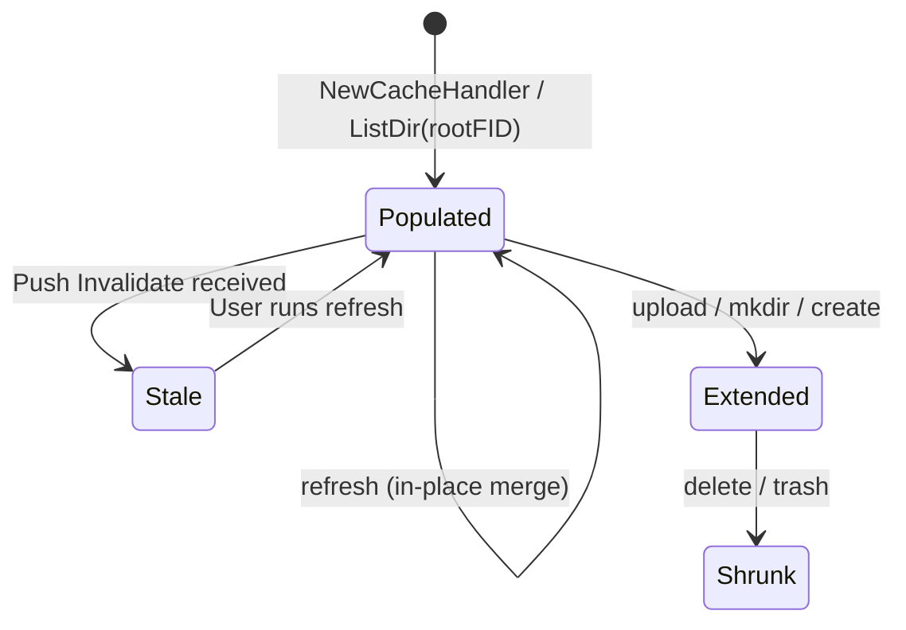
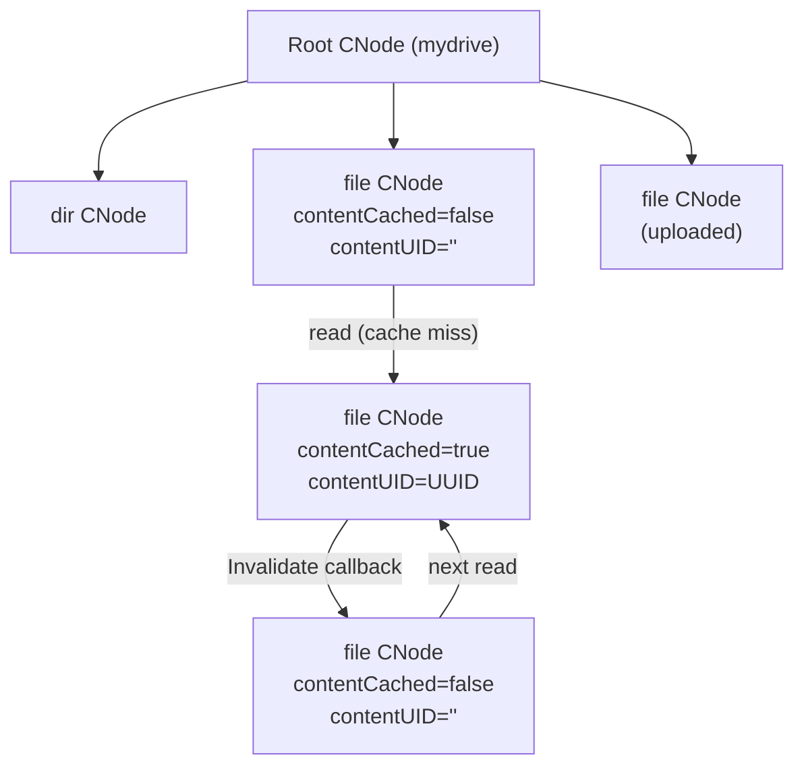

# Client-Side Caching & Pushed Invalidations

This document details the DVFS client caching architecture, split into its theoretical foundation (**In Essence**) and its concrete engineering realities (**Implementation Quirks**).

---

## 1. In Essence: The AFS Caching Model

### Whole-File Caching
DVFS adopts the client caching philosophy pioneered by the Andrew File System (AFS). Rather than transferring file data in small block-level requests over the network during every read call, the client fetches the entire file upon first access and caches it on the local filesystem.

Subsequent reads are served directly from local storage with **zero network latency and zero RPC overhead**.

```
[Client Application]
         |
         v
  [Check Cache]
    /         \
 (Hit)       (Miss)
  /             \
Read Local    Download Entire File
Cache File    into Local Cache File
                |
                v
          Mark Cached & Read
```

### Server-Driven Invalidation Callbacks
Local caching creates a cache coherence challenge: if User A updates a file that User B has cached, User B might read stale data.

DVFS resolves this with **server-pushed invalidations**:
- After connecting, each client opens a long-lived `WatchEvents` stream to its FileServer. The client dials out, exactly like every other RPC, so this works behind NAT, campus Wi-Fi and client firewalls and needs no listening port on the client.
- The FileServer tracks which directory each session is in. When any user changes that directory (create, mkdir, upload, write, delete, trash, restore), the FileServer pushes an event down the streams of the other users in it.
- On an event the client drops the stale cached file or marks the directory listing stale; the next `ls`, `cd` or `read` re-fetches from the server.

This push-invalidation architecture completely eliminates repetitive "check if modified" polling requests, preserving network bandwidth and fileserver CPU cycles.

---

## 2. Implementation Quirks & Practical Realities

### 2.1 The CNode Tree Hierarchy
The client represents cached directory metadata as a tree of `CNode` structs (`internal/client/cache_handler.go`):

```go
type CNode struct {
    Name          string
    Type          domain.InodeType  // InodeTypeFile (0) or InodeTypeDirectory (1)
    fid           *domain.FID       // Remote File Identifier
    Size          uint64            // Cached file size in bytes
    children      map[string]*CNode // Child directory nodes
    contentCached bool              // True if file bytes are cached locally
    contentUID    string            // UUID matching ./.cache/<UUID>
    parent        *CNode            // Parent directory pointer
}
```

- **Tree Mirroring**: When navigating with `cd`, the client walks its local CNode tree.
- **Size Caching**: Unlike early development prototypes, file sizes are cached directly in `CNode.Size` and updated whenever `ListFilesAt` or upload operations execute.
- **In-Place Cache Merging**: When running `refresh` or re-entering a directory, `populateCurrentDirCache` merges server listings into existing CNodes. If a file is already cached and its size has not changed, its `contentCached` status and local UUID file are preserved. Old CNodes whose names still appear in the server listing are updated in-place, new server entries create fresh CNodes, and removed entries are dropped.

#### CNode Lifecycle State Machine



#### CNode File Content Caching Transition



### 2.2 Local UUID Content Storage (`./.cache/`)
Cached files are stored in `./.cache/` relative to the client binary:
- Each cached file is given a unique version 4 UUID name (e.g., `./.cache/4a9c687e-85eb-42d3-9bc3-7a912bb0e182`).
- UUID naming prevents local path collisions when files with the same name exist in different directories or roots.
- On client exit (`exit`), `h.cacheHandler.ClearCache()` automatically unlinks all UUID files and removes `./.cache/`.

### 2.3 Push Event Types
The FileServer event sender (`internal/fileserver/callback_server.go`) issues three distinct invalidation event codes:

```
+--------------------------+------------+--------------------------------------------+
| Event Constant           | Enum Value | Trigger Source                             |
+--------------------------+------------+--------------------------------------------+
| callbackEventFileUpdated | 1          | UploadFile completion, WriteFile           |
| callbackEventDirNewFile  | 2          | CreateFile (file or directory), RestoreFile |
| callbackEventFileDeleted | 3          | DeleteFile, TrashFile, failed-upload cleanup |
+--------------------------+------------+--------------------------------------------+
```

Events travel in `WatchEvent.event_type` on the `WatchEvents` stream (`api/fileserver/fileserver.proto`). `event_type = 0` is the server's "stream is live" message and a keepalive sent every 20 s, which keeps NAT/firewall mappings open and lets both ends notice a dead connection.

Events arrive on a background goroutine, so the client (`internal/client/event_stream.go`, `handleInvalidation`) only queues them; the shell applies the queue before the next command, so the cache tree is never touched concurrently:
1. **`FILE_UPDATED`**: Deletes the local `./.cache/<contentUID>` file, sets `contentCached = false`, and re-fetches the parent listing (sizes).
2. **`DIR_NEW_FILE`** / **`FILE_DELETED`**: Marks the directory's listing stale; it is re-fetched on the next `ls`/`cd`.

**Reconnects.** If the stream drops (server restart, network blip), the client reconnects with exponential backoff (1 s up to 30 s). After reconnecting it re-sends its current directory and re-fetches it, since events may have been missed. If the server rejects the session (expired, or the machine's IP changed), the client prints a notice and `refresh` re-registers and reopens the stream.

**Legacy callbacks.** A FileServer that predates `WatchEvents` answers `Unimplemented`; the client then falls back to the old model: it opens an inbound listener (`internal/client/callback_server.go`) and the FileServer dials it with `callback.Invalidate`. That path only works when the FileServer can reach the client directly (no NAT, no blocking firewall).

### 2.4 Event Session Targeting
Broadcasting events to every known client would degrade performance. The FileServer filters targets strictly:
- **Directory Matching**: Events are only delivered to sessions whose `currentDirFID` matches the directory where the event occurred. Each client reports its directory on every `cd` and in a 15 s heartbeat; with authentication, only the caller's own session is updated.
- **Origin Exclusion**: The user who triggered the modification is excluded from notifications (their local cache is already updated).
- **Liveness**: A session with an open `WatchEvents` stream is always a target. Legacy (callback-only) sessions are skipped after 45 s without activity (`activeSessionTTL`).
- **Multiple clients per user**: Each running client has its own stream, and every stream of the user receives the event.
- **Slow clients**: Each stream buffers up to 256 events; a client that falls further behind is disconnected and resyncs when it reconnects, so it can never stall the FileServer.
- **Failure Pruning (legacy)**: If dialing a client's callback listener fails 3 consecutive times (`maxCallbackFailures = 3`), the session is purged from `fs.sessions`.

### 2.5 Client Session Lifecycle: Graceful Disconnect & Re-Registration
Maintaining accurate connection counts on FileServers and Admin Dashboards requires deterministic lifecycle hooks:
- **Graceful Disconnect (`UnregisterClient`)**:
  - When a client exits cleanly (`exit`), switches storage roots (`cd ..` at root), or receives an OS interrupt (`SIGINT`/`SIGTERM` trapped via Go signals), `Client.Disconnect()` dispatches an `UnregisterClient` RPC to the FileServer before terminating.
  - The client closes its `WatchEvents` stream first; the FileServer then removes the session from `fs.sessions`, closes any remaining streams for it, and decrements its active connections metric.
- **Session Self-Healing (`ReRegister`)**:
  - If a FileServer crashes and reboots while a client remains open, the FileServer's in-memory callback sessions are lost.
  - When the client executes `refresh` (or navigates directories), `CacheHandler.Refresh()` invokes `Client.ReRegister()`.
  - The client re-registers with the FileServer, verifies the root FID has not shifted, and reopens its `WatchEvents` stream, restoring push notification delivery without client restarts. (After a FileServer restart the stream also reconnects on its own.)

### 2.6 Terminal Prompt Safety (`SetNotifyWriter`)
Because callbacks are received asynchronously over gRPC, printing alerts while the user is typing would corrupt the interactive readline prompt. 
DVFS integrates callbacks with the readline library:
- When the REPL loop starts, it registers `rl.Stdout()` via `client.SetNotifyWriter(rl.Stdout())`.
- Callback notifications write to this stream, which cleanly redraws the current input buffer and the `dvfs>` prompt on a new line.

### 2.7 Cache Inspection (`viscache`)
Users can visualize their client's in-memory CNode tree at any time using the `viscache` command:
```text
dvfs> viscache
Cache Structure:
- mydrive (directory)
  - documents (directory)
    - notes.txt (file (cached: true))
  - report.pdf (file (cached: false))
```

## Diagrams

For visual architecture maps, sequence diagrams, and flowcharts describing the client shell, callback handlers, and interactive state lifecycle, please refer to:
- [Client System Architecture Diagrams](./../diagrams/client_system.md)
